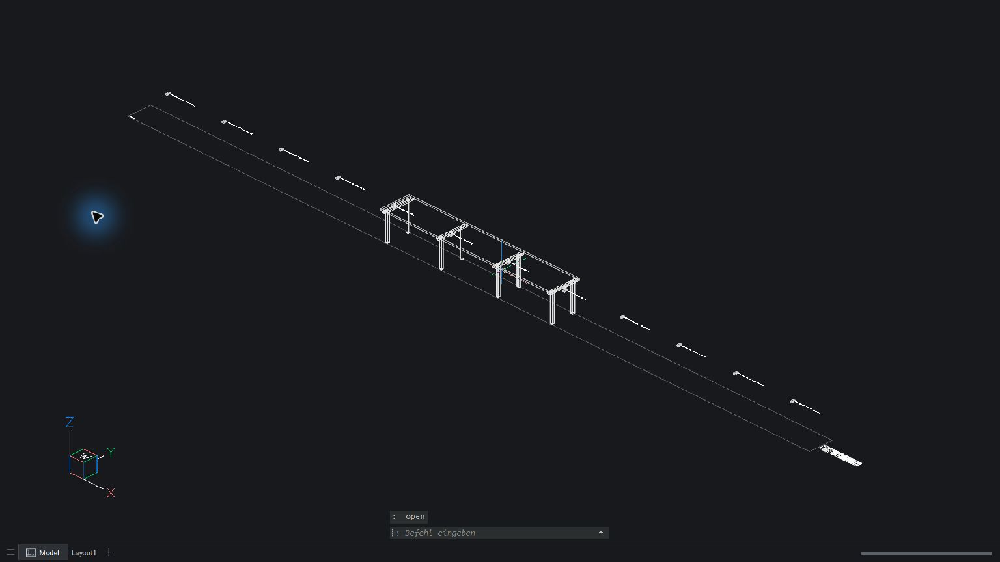
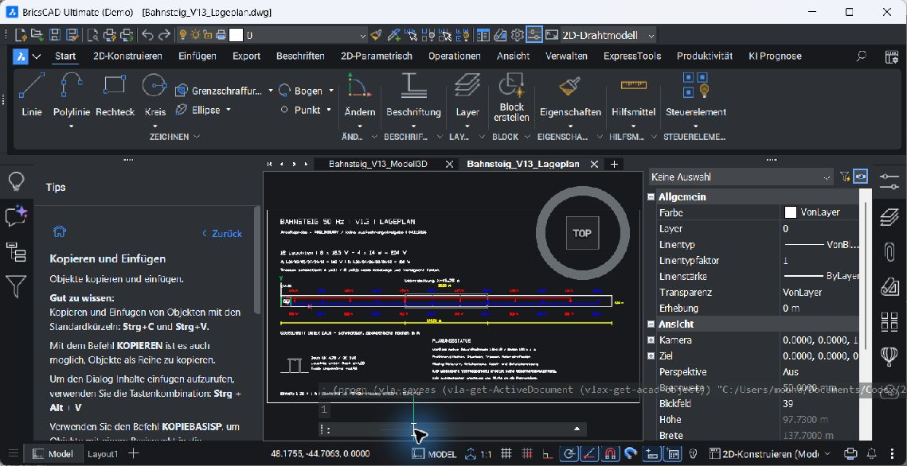
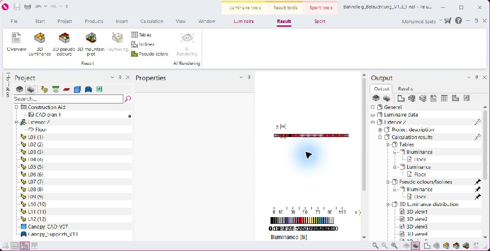
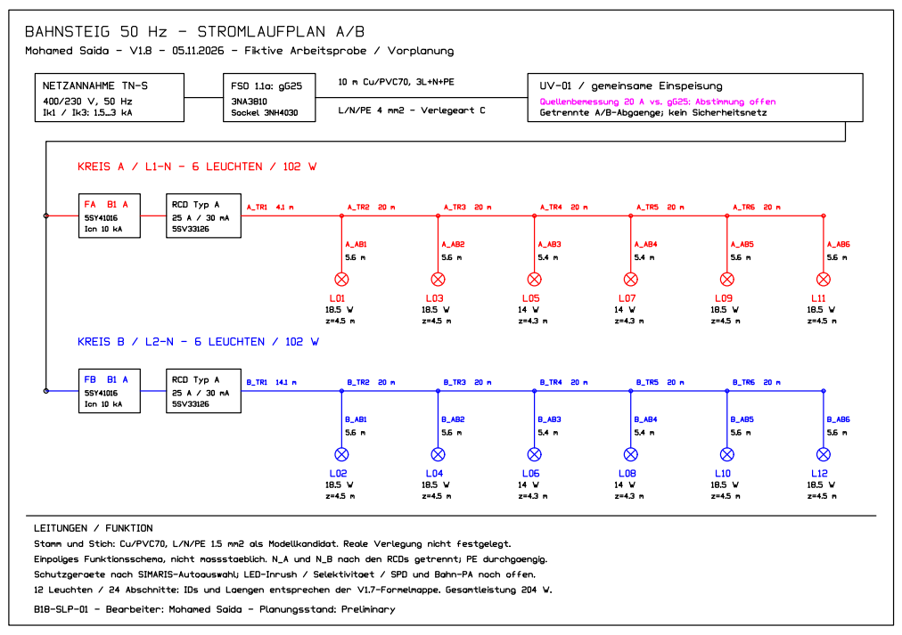
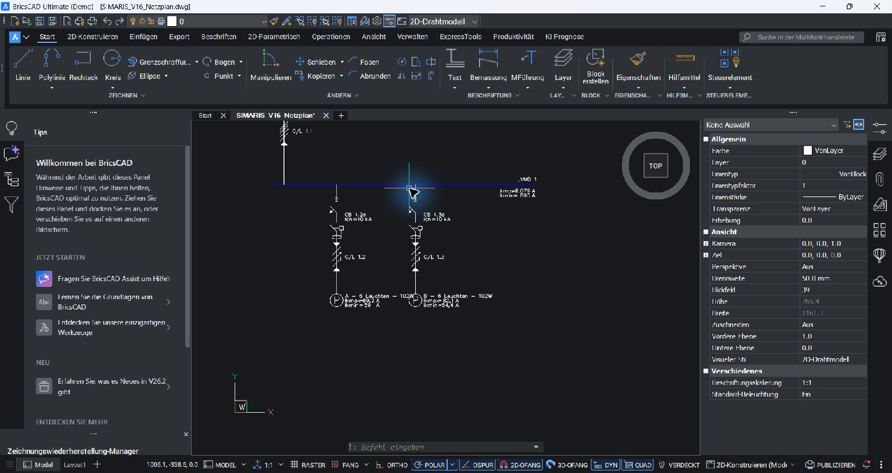

# Elektroplanung eines Bahnsteigs bei 50 Hz

### BricsCAD · ReluxDesktop · SIMARIS design · Excel

**Mohamed Saida | Technische Arbeitsprobe / Portfolio-Projekt | V1.8**

Fiktive Modernisierung der **Allgemeinbeleuchtung eines 120 m × 4 m großen Bahnsteigs**: von der CAD-Koordination über die Lichtsimulation bis zur elektrischen Vorplanung und einer eigenen abschnittsweisen Spannungsfallberechnung.

*BricsCAD V26 – koordinierte 3D-Gesamtansicht. Originalansicht aus dem Projekt; keine KI-generierte Visualisierung.*

## Einstieg für die fachliche Durchsicht

| Dokument | Inhalt |
|---|---|
| **[Kurzüberblick – 3 Seiten (PDF)](07_Projektstaende/Bahnsteig_V1.8_Arbeitsprobe/00_Vorstellung/01_Arbeitsprobe_Mohamed_Saida_Kurzueberblick.pdf)** | Aufgabe, Vorgehensweise und wichtigste Ergebnisse in kompakter Form |
| **[Technischer Projektbericht – GitHub-Lesefassung](docs/TECHNISCHER_PROJEKTBERICHT_LESFASSUNG.md)** | Technische Schritte, Bilder, Vergleich der Berechnungsmodelle und offene Nachweise |
| **[Nachweismappe – 44 Seiten (PDF)](07_Projektstaende/Bahnsteig_V1.8_Arbeitsprobe/00_Vorstellung/00_Nachweismappe_Mohamed_Saida.pdf)** | Zusammenstellung der originalen CAD-, SIMARIS- und Relux-Ausgaben mit Lesezeichen |
| **[HD-Abbildungen für den Bericht](07_Projektstaende/Bericht_Abbildungen_HD/README.md)** | Originale BricsCAD-Ansichten und PDF-basierte Darstellungen in hoher Auflösung, mit Herkunft und Seitenzuordnung |

> **Einordnung:** Eigenständiges Demonstrations- und Lernprojekt, kein offizielles Projekt der Deutschen Bahn oder von GFK Ingenieure. Die vorhandenen Ergebnisse sind eine fachlich dokumentierte **Vorplanung**, keine prüffähige oder freigegebene Ausführungsplanung.

## Projekt auf einen Blick

| Parameter | Dokumentierter Stand |
|---|---|
| Geometrie | 120 m Bahnsteiglänge × 4 m Breite; 30 m mittige Überdachung |
| Beleuchtung | 12 Leuchten: 8 × 18,5 W + 4 × 14 W = **204 W** |
| Aufteilung | **Stromkreis A: 102 W** / **Stromkreis B: 102 W**, alternierende Leuchtenzuordnung |
| Relux-Simulation | **Em 18,1 lx**, Emin 7,96 lx, Emax 37 lx, U0 **0,44** |
| Elektrische Netzannahme | 400/230 V, 50 Hz, TN-S; zwei in SIMARIS modellierte Ersatzlasten |
| Spannungsfall SIMARIS | **A 0,596 % / B 0,649 %** – konzentrierte Endlasten |
| Eigene Abschnittsrechnung | **A 0,329376 % / B 0,387322 %** – zwölf verteilte Leuchten, 24 Leitungsabschnitte |

**Wichtig zum Vergleich:** SIMARIS und die Excel-Referenz verwenden unterschiedliche Lastverteilungen und zum Teil andere Rechenannahmen. Die Werte sind **nicht** zwei identische Netzmodelle.

## Einblicke in die Projektarbeit

| CAD-Lageplan | Beleuchtungssimulation |
|:--:|:--:|
|  |  |
| **BricsCAD:** Leuchtenpositionen, Dachbereich und schematische Wege | **Relux:** berechnete Lichtverteilung der Allgemeinbeleuchtung |

| Elektrischer Detailstromlaufplan | SIMARIS-Netzmodell |
|:--:|:--:|
|  |  |
| **BricsCAD:** zwölf Leuchten, A/B-Stromkreise und 24 Stamm-/Stich-IDs | **SIMARIS:** Netzstruktur, Lastannahmen und Berechnungsausgaben |

Die vollständigen Planseiten sind zusätzlich als **[hochauflösende Abbildungen](07_Projektstaende/Bericht_Abbildungen_HD/README.md)** und in den **[Original-PDFs](07_Projektstaende/Bahnsteig_V1.8_Arbeitsprobe/00_Vorstellung/README.md)** abgelegt.

## So bin ich vorgegangen

**01 — Grundlagen und Modell prüfen.** Vorhandene Relux-/CAD-Dateien gesichert, Geometrie und Leuchtenpositionen abgeglichen; daraus einen nachvollziehbaren Arbeitsstand entwickelt.

**02 — BricsCAD-Zeichnungen koordinieren.** Lageplan und 3D-Geometrie mit mittiger Überdachung betrachtet, Dachstützen/Träger ergänzt bzw. koordiniert und technische Zeichnungen abgeleitet. [Lageplan als PDF](07_Projektstaende/Bahnsteig_V1.8_Arbeitsprobe/02_CAD/Bahnsteig_V13_Lageplan.pdf)

**03 — Beleuchtung mit Relux auswerten.** Zwölf vorhandene Leuchten im koordinierten Modell beibehalten, nach Geometrieergänzung neu gerechnet und Isolux-/Falschfarbenbilder sowie den Originalbericht ausgewertet. [Relux-Originalbericht (PDF)](07_Projektstaende/Bahnsteig_V1.8_Arbeitsprobe/00_Vorstellung/06_Relux_Originalbericht.pdf)

**04 — Stromkreise A/B detaillieren.** Alternierende Leuchtenzuordnung und Stamm-/Stich-Abschnitte in einen lesbaren Detailstromlaufplan überführt. [Detailstromlaufplan (PDF)](07_Projektstaende/Bahnsteig_V1.8_Arbeitsprobe/00_Vorstellung/02_Detailstromlaufplan.pdf)

**05 — Elektrische Vorplanung in SIMARIS.** TN-S-Beispielnetz mit Unterverteilung, Zuleitung und zwei gebündelten 102-W-Endlasten modelliert; native Berechnungsberichte, Kurzschlussdaten und Schutzkennlinien dokumentiert. [SIMARIS-Berechnungsbericht (PDF)](07_Projektstaende/Bahnsteig_V1.8_Arbeitsprobe/00_Vorstellung/03_SIMARIS_Berechnung.pdf)

**06 — Verteilte Lasten selbst rechnen.** Für zwölf Leuchten die Strom- und Spannungsfallwerte entlang von 24 Leitungsabschnitten in einer bearbeitbaren Excel-Formelmappe berechnet und die Modellunterschiede erläutert. [Excel-Rechnung](07_Projektstaende/Bahnsteig_V1.8_Arbeitsprobe/03_Elektro/Bahnsteig_V17_Leitungsberechnung.xlsx)

**07 — Nachweise strukturiert dokumentieren.** Originalausgaben, bearbeitbare Dateien, Versionsstände, Bildquellen und einen Prüfstatus getrennt aufbewahrt. [Prüfstatus](07_Projektstaende/Bahnsteig_V1.8_Arbeitsprobe/PRUEFSTATUS.csv)

## Technische Erkenntnisse und offene Nachweise

Der Schwerpunkt der Arbeitsprobe liegt darauf, **Zusammenhänge zwischen CAD, Lichtberechnung, Netzberechnung und elektrischen Details nachvollziehbar zu machen** und Rechenergebnisse kritisch einzuordnen.

Für eine reale Ausführung wären u. a. noch Netzdaten und tatsächliche Verlegebedingungen, die Schutzgerätekoordination und vollständige Selektivität, LED-Einschaltströme, SPD, Bahnpotenzialausgleich sowie projektbezogene Beleuchtungsanforderungen und Sicherheitsbeleuchtung zu prüfen. Auch die dokumentierte 20-A-Quellenbemessung gegenüber gG25 erfordert eine gesonderte Bewertung.

**Keine normative Konformität, Ausführungsfreigabe oder geprüfte Schutzkoordination wird mit dieser Arbeitsprobe behauptet.**

## Dateien gezielt öffnen

- **[V1.8-Arbeitsprobe mit bearbeitbaren Dateien](07_Projektstaende/Bahnsteig_V1.8_Arbeitsprobe/README.md)** – Relux-RDF, BricsCAD-DWG/DXF, SIMARIS-SDX/SX, Excel und native Ausgaben.
- **[Original-Screenshots und Bildverzeichnis](07_Projektstaende/Bahnsteig_V1.8_Arbeitsprobe/04_Screenshots/VERZEICHNIS.md)** – Softwareansichten und Tabellen.
- **[HD-Bildstrecke](07_Projektstaende/Bericht_Abbildungen_HD/README.md)** – Abbildungen, Auflösung und originale PDF-Quellen.
- **[Technischer Bericht als GitHub-Lesefassung](docs/TECHNISCHER_PROJEKTBERICHT_LESFASSUNG.md)** – zusammenhängende Erklärung mit ausgewählten Bildern.
- **[Bisheriger README-Stand (Archiv)](docs/README_ARCHIV_BIS_2026-11-14.md)** – ursprüngliche Dokumentation und historische Versionshinweise.

---

**Bearbeiter:** Mohamed Saida · **Fachgebiet:** Elektrotechnik · **Technische Grundlage:** 05.11.2026 · **Überarbeitung der GitHub-Präsentation:** 14.11.2026

*Die technische V1.8-Projektbasis und die Originaldateien wurden durch diese README-Überarbeitung nicht geändert.*
