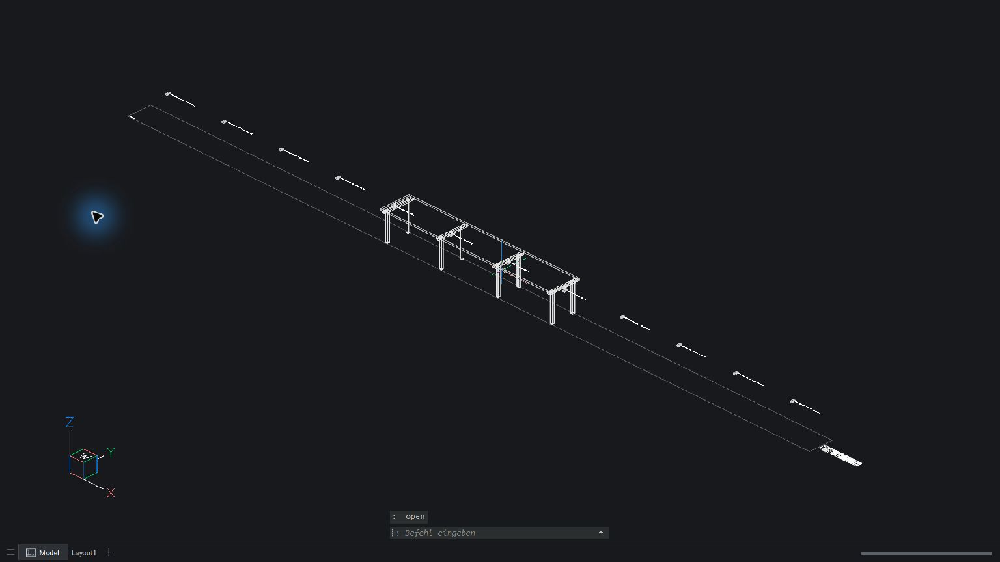
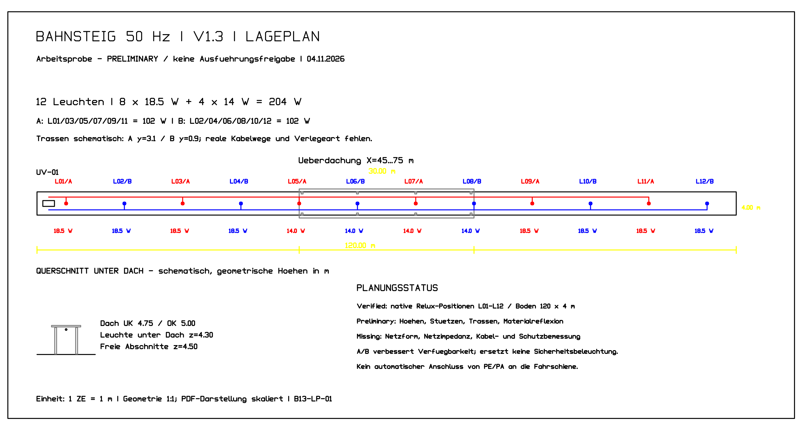
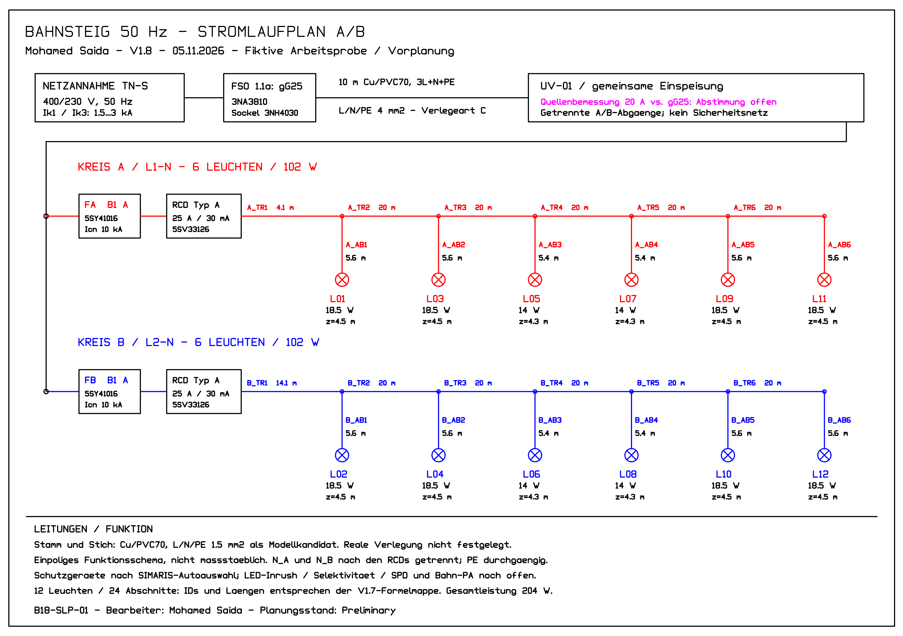
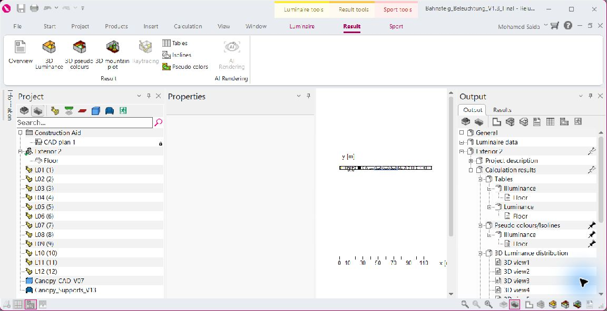
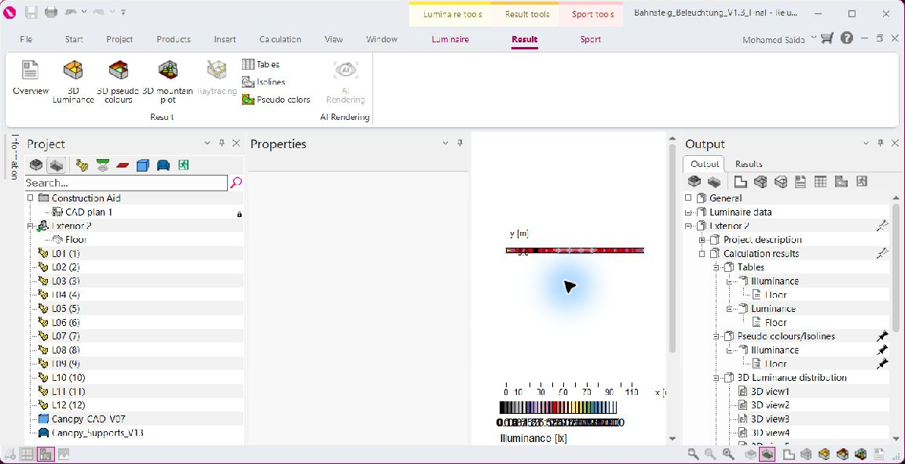
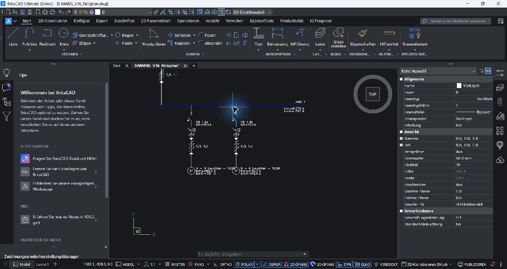
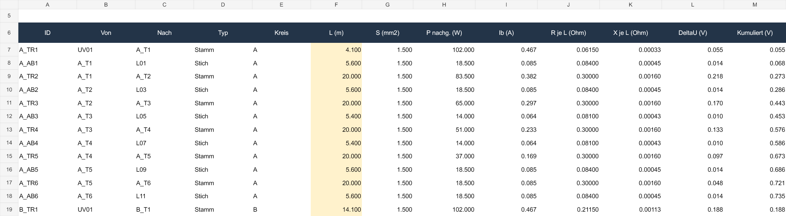

# Technischer Projektbericht – Bahnsteig 50 Hz

**Elektrotechnische Vorplanung einer fiktiven Bahnsteigmodernisierung**  
**Bearbeiter:** Mohamed Saida · **Projektstand:** V1.8 · **Datengrundlage:** 05.11.2026

> **Projektstatus:** Eigenständige technische Arbeitsprobe / Demonstrationsprojekt. Keine Planung im Auftrag der Deutschen Bahn oder von GFK Ingenieure und keine geprüfte Ausführungsplanung. Der hier erläuterte Rechen- und Dokumentationsstand basiert auf den unveränderten Originaldateien der Versionen V1.3–V1.8.

**Schnelleinstieg:** [Dreiseitiger Kurzüberblick (PDF)](../07_Projektstaende/Bahnsteig_V1.8_Arbeitsprobe/00_Vorstellung/01_Arbeitsprobe_Mohamed_Saida_Kurzueberblick.pdf) · [44-seitige Nachweismappe mit Originalausgaben (PDF)](../07_Projektstaende/Bahnsteig_V1.8_Arbeitsprobe/00_Vorstellung/00_Nachweismappe_Mohamed_Saida.pdf) · [HD-Abbildungen](../07_Projektstaende/Bericht_Abbildungen_HD/README.md)

## 1. Aufgabe und Vorgehensweise

Ziel war eine nachvollziehbare elektrische Vorplanung für die Allgemeinbeleuchtung eines fiktiven Bahnsteigs. Die Arbeitsprobe verbindet vier Planungsbausteine:

1. **BricsCAD:** Lageplan, Koordinationsmodell, Kabelwege und Detailstromlaufplan.
2. **ReluxDesktop:** Übernahme der koordinierten Geometrie und Beleuchtungssimulation.
3. **SIMARIS design:** Beispielhafte Niederspannungsnetzberechnung mit zwei Ersatzlasten.
4. **Excel:** Eigene Berechnung von zwölf verteilten Leuchtenlasten über 24 Leitungsabschnitte.

Im Projekt wurden vorhandene V1.2-Grundlagen gesichert und schrittweise erweitert. Das Projekt ist **kein von Grund auf neu aufgenommenes Bestandsprojekt**; Bestandsdaten und netzbetreiberseitige Angaben sind lediglich Szenarioannahmen.

## 2. BricsCAD – Lageplan, Geometrie und Stromkreise

| Kenngröße | Planungsansatz |
|---|---|
| Bahnsteig | 120 m × 4 m |
| Überdachung | 30 m im zentralen Abschnitt, x = 45–75 m |
| Beleuchtung | 12 Leuchten, auf zwei Stromkreise verteilt |
| Leuchtenleistung | 8 × 18,5 W + 4 × 14 W = **204 W** |
| Stromkreis A | L01, L03, L05, L07, L09, L11 = **102 W** |
| Stromkreis B | L02, L04, L06, L08, L10, L12 = **102 W** |

Die Zeichnungen zeigen Lage, Überdachung und Leuchtenpositionen. Das 3D-Koordinationsmodell macht insbesondere die Geometrie von Dachstützen und Trägern nachvollziehbar. Die **A/B-Aufteilung** verbessert die Verfügbarkeit bei Ausfall eines Abgangs, ersetzt aber keine nachzuweisende Sicherheitsbeleuchtung. Auch die gemeinsame Einspeisung bleibt ein gemeinsamer Ausfallpunkt.

*Abbildung 1: BricsCAD-Gesamtansicht des Bahnsteigmodells.*

*Abbildung 2: Lageplan mit zwölf Leuchten. Die Trassen sind schematisch, nicht vermessen.*

Der aktuelle Detailstromlaufplan ordnet den beiden Abgängen die zwölf Leuchten und **24 Stamm-/Stich-Abschnitte** zu. Dazu liegen eine bearbeitbare DWG/DXF-Datei und eine PDF-Ausgabe vor.

**Nachweise:** [Detailstromlaufplan (PDF)](../07_Projektstaende/Bahnsteig_V1.8_Arbeitsprobe/00_Vorstellung/02_Detailstromlaufplan.pdf) · [DWG-Datei](../07_Projektstaende/Bahnsteig_V1.8_Arbeitsprobe/02_CAD/Bahnsteig_Mohamed_Saida_Detailstromlaufplan.dwg)

*Abbildung 3: Detailstromlaufplan mit A/B-Zuordnung; Gerätekandidaten sind keine technische Freigabe.*

## 3. ReluxDesktop – Beleuchtungsmodell und Auswertung

Ausgangspunkt war ein gesichertes Relux-V1.2-Modell. Für V1.3 wurden koordinierte Dachstützen und Träger ergänzt; die zwölf vorhandenen Leuchten und die Grundgeometrie blieben erhalten. Anschließend wurde die Beleuchtung neu berechnet und mit Isolux- und Falschfarbenansichten dokumentiert.

**Auswertung:** Szene *Exterior 2*, horizontales Raster *Floor (E)*, Wartungsfaktor 0,8.

| Kenngröße | Simuliertes Ergebnis |
|---|---:|
| Mittlere Beleuchtungsstärke Em | **18,1 lx** |
| Minimale Beleuchtungsstärke Emin | **7,96 lx** |
| Maximale Beleuchtungsstärke Emax | **37 lx** |
| Gleichmäßigkeit U0 = Emin / Em | **0,44** |

Die Ergebnisse beschreiben das gewählte Modell. Daraus folgt **noch kein Nachweis**, dass alle relevanten Sollwerte der konkreten Bahnanlage erfüllt sind.

*Abbildung 4: Simulierte Isoluxdarstellung.*

*Abbildung 5: Falschfarbenansicht der Beleuchtungsberechnung.*

**Originalbelege:** [Relux-Gesamtbericht (PDF)](../07_Projektstaende/Bahnsteig_V1.8_Arbeitsprobe/00_Vorstellung/06_Relux_Originalbericht.pdf) · [Bearbeitbare Relux-Datei](../07_Projektstaende/Bahnsteig_V1.8_Arbeitsprobe/01_Relux/Bahnsteig_Beleuchtung_V1.3_Final.rdf)

## 4. SIMARIS – elektrische Netzvorplanung

In SIMARIS design wurde ein beispielhaftes TN-S-Niederspannungsnetz mit **400/230 V, 50 Hz** aufgebaut. Die Unterverteilung ist durch eine angenommene **10 m lange Cu-Zuleitung mit 4 mm²** versorgt. Die Abgänge A und B wurden mit **1,5 mm² Cu** und jeweils **102 W** als gebündelte Endlast modelliert.

| SIMARIS-Szenario | Abgang A | Abgang B |
|---|---:|---:|
| Ersatzlast | 102 W | 102 W |
| Schematische Leitungslänge | 109,7 m | 119,7 m |
| Kumulierter Spannungsfall | **0,596 %** | **0,649 %** |
| Minimaler Ik1-Endfehlerstrom gemäß nativem Bericht | 59,029 A | 54,374 A |

Diese Werte stammen aus der bestehenden **nativen SIMARIS-Rechnung**. Es handelt sich ausdrücklich um **zwei konzentrierte Ersatzlasten**, nicht um eine native zwölfknotige, leuchtenweise Netzrechnung.

*Abbildung 6: Dokumentierte Netzstruktur der SIMARIS-Vorplanung.*

**Originalbelege:** [SIMARIS-Berechnungsbericht (PDF)](../07_Projektstaende/Bahnsteig_V1.8_Arbeitsprobe/00_Vorstellung/03_SIMARIS_Berechnung.pdf) · [Schutzkennlinien (PDF)](../07_Projektstaende/Bahnsteig_V1.8_Arbeitsprobe/00_Vorstellung/04_SIMARIS_Schutzkennlinien.pdf) · [Netzansichten (PDF)](../07_Projektstaende/Bahnsteig_V1.8_Arbeitsprobe/00_Vorstellung/05_SIMARIS_Netzansichten.pdf)

## 5. Excel – Leitungsabschnitte mit verteilten Leuchtenlasten

Um den Einfluss der **Lastverteilung** zu untersuchen, wurde ergänzend eine transparente Abschnittsrechnung aufgebaut:

- Pro Stromkreis sechs Stammstücke und sechs Stichleitungen, zusammen **24 Abschnitte**.
- Jedes Stammstück berücksichtigt nur die hinter diesem Abschnitt angeschlossenen Leuchten; Stichleitungen jeweils eine Leuchte.
- Die Spannungsfälle werden bis zur jeweiligen Leuchte entlang des Leitungswegs summiert.
- Eingaben wie Abschnittslänge und Lasten können in der Excel-Arbeitsmappe nachvollzogen und geändert werden.

| Ergebnis | Abgang A | Abgang B |
|---|---:|---:|
| Maximaler kumulierter Referenz-Spannungsfall | **0,329376 %** | **0,387322 %** |
| Vergleichswert aus SIMARIS-Ersatzlastmodell | 0,596 % | 0,649 % |

Die Differenz ist **kein Softwarefehler**: SIMARIS bündelt die vollständige Leistung am Leitungsende; die Abschnittsrechnung bildet die räumliche Lastverteilung ab. Außerdem unterscheiden sich einzelne Widerstands- und Modellannahmen. Ein direkter Validierungstest der Programme wäre daraus nicht ableitbar.

*Abbildung 7: Dokumentierte abschnittsweise Leitungsberechnung.*

**Bearbeitbare Datei:** [Bahnsteig V1.7 Leitungsberechnung (XLSX)](../07_Projektstaende/Bahnsteig_V1.8_Arbeitsprobe/03_Elektro/Bahnsteig_V17_Leitungsberechnung.xlsx) · [Rechenweg und Prüfungen](../07_Projektstaende/Bahnsteig_V1.8_Arbeitsprobe/03_Elektro/DETAILRECHNUNG_V17.md)

## 6. Technische Bewertung und Grenzen

Die vorhandenen Unterlagen demonstrieren ein zusammenhängendes Vorgehen von der Geometrie über die Lichtsimulation bis zur elektrischen Netzvorplanung. **Ein erfolgreicher Software-Rechenlauf ist keine Ausführungsfreigabe.**

Für eine reale technische Planung fehlen bzw. bedürfen insbesondere die folgenden Punkte einer zusätzlichen fachlichen Prüfung:

- Gesicherte Netzbetreiber- und Bestandsdaten sowie tatsächliche Trassen- und Verlegebedingungen.
- Fachgerechte Auswahl und Koordination der Schutzeinrichtungen. Die im Szenario enthaltene **20-A-Quellenbemessung gegenüber gG25** ist ein offener Prüffund.
- Herstellerdaten zu LED-Einschaltströmen, vollständige Selektivität und RCD-Eignung.
- Überspannungsschutz (SPD), Erdung, Bahnpotenzialausgleich sowie Schnittstellen zu anderen Gewerken.
- Projektbezogene Beleuchtungsanforderungen, Sicherheitsbeleuchtung und abschließender Nachweis der relevanten Regelwerke.

Dazu siehe [Prüfstatus V1.8](../07_Projektstaende/Bahnsteig_V1.8_Arbeitsprobe/PRUEFSTATUS.csv).

## 7. Nachvollziehbarer Entwicklungsverlauf

| Stand | Entwicklung |
|---|---|
| V1.2 | Vorhandene CAD-/Relux-Grundlagen gesichert |
| V1.3 | Dachstützen-/Trägergeometrie koordiniert und Relux-Auswertung aktualisiert |
| V1.5 | Historisches ELEK-Free-Vergleichsmodell und CAD-Abgabe |
| V1.6 | Natives SIMARIS-Modell mit Ersatzlasten und Originalexporten |
| V1.7 | Eigene Excel-Abschnittsrechnung für zwölf Leuchten und 24 Abschnitte |
| V1.8 | Zusammenstellung der Vorstellungsmaterialien, neue benannte SIMARIS-Exporte und Detailstromlaufplan |
| Ergänzung 05.11.2026 | HD-Abbildungen aus nativen Ansichten und PDF-Ausgaben, **ohne** Änderung der Licht- oder Elektroberechnungen |

Die ursprünglichen Dateien und Versionen bleiben getrennt gespeichert. Die Ansichten in dieser Lesefassung stammen aus den dokumentierten Projektdateien; sie sind keine nachträglich generierten technischen Berechnungsergebnisse.

## 8. Dateien und Lesereihenfolge

**Für die fachliche Durchsicht:**

1. [Kurzüberblick – 3 Seiten (PDF)](../07_Projektstaende/Bahnsteig_V1.8_Arbeitsprobe/00_Vorstellung/01_Arbeitsprobe_Mohamed_Saida_Kurzueberblick.pdf)
2. [Nachweismappe – 44 Seiten mit Originalausgaben (PDF)](../07_Projektstaende/Bahnsteig_V1.8_Arbeitsprobe/00_Vorstellung/00_Nachweismappe_Mohamed_Saida.pdf)
3. [HD-Bildmaterial mit Herkunftsnachweisen](../07_Projektstaende/Bericht_Abbildungen_HD/README.md)
4. [V1.8-Projektstand und editierbare Dateien](../07_Projektstaende/Bahnsteig_V1.8_Arbeitsprobe/README.md)
5. [Prüfprotokoll und offene Punkte](../07_Projektstaende/Bahnsteig_V1.8_Arbeitsprobe/PRUEFPROTOKOLL.md)

**Hinweis zum ausführlichen PDF:** Der separat erstellte 64-seitige Bericht *Bahnsteig_Overleaf_Ueberarbeitet.pdf* existiert außerhalb dieses Repositorys. Diese GitHub-Lesefassung ersetzt **nicht** dessen Original-PDF, sondern bietet hier bereits einen direkt lesbaren fachlichen Zugang zu den dokumentierten Ergebnissen und den im Repository verfügbaren Abbildungen.

---

**Mohamed Saida · Eigenständige technische Arbeitsprobe · Stand der Nachweise: 05.11.2026**
